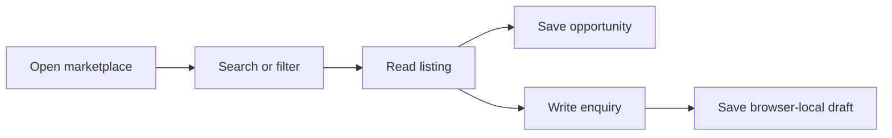
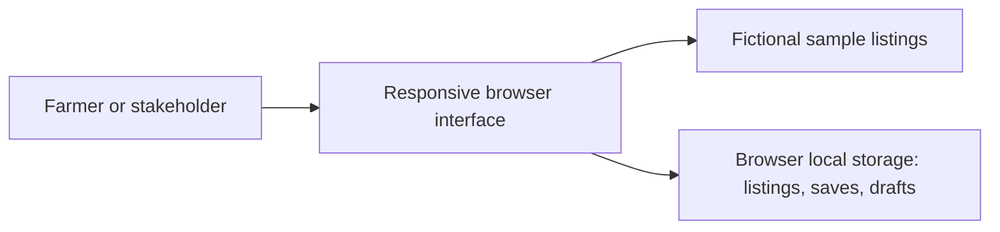

# Phase 1 — Marketplace prototype

Status: draft, 2026-11-05. Owner review pending.

## Confirmed scope
Sri Lankan farmers connect directly with produce buyers, transport providers, fertilizer suppliers, agricultural land sellers and exporters. Farmers are the primary audience. Start with discovery, listings and direct enquiries; transactions come later.

## Requirements implemented locally
- FD-REQ-001: Browse five stakeholder marketplace categories.
- FD-REQ-002: Search title, description, owner and district; filter by district and sort by title.
- FD-REQ-003: Read listing details and save opportunities.
- FD-REQ-004: Create a device-local listing.
- FD-REQ-005: Save and delete enquiry drafts without sending them.
- FD-REQ-006: Adapt the interface to phone and desktop browser widths.

## Flow / activity

## Current architecture

No server, verified identity or message recipient exists in this phase. Proposed production architecture is mobile/desktop clients → authenticated Workers API → D1; uploads may use R2. No client should contain Cloudflare credentials.

## Diagram register
Flowchart/activity and architecture sketches above describe this prototype. Formal use-case, sequence, ERD, class and cause-effect baselines await account roles, permissions, data retention and messaging rules. These sketches are not approved design baselines or a completed eight-diagram set.

## Open decisions
Android/iOS and Windows/macOS/Linux support; installable apps versus browser distribution; Sinhala/Tamil/English; listing approval and supplier verification; contact privacy; account sign-in method; budget and Cloudflare account configuration.

## Wholesale and registration update
Confirmed: no retail sales. Public browsing remains available; listing creation requires registration and a signed-in profile. Registration collects name/business, Sri Lankan mobile number, role, district and wholesale-only acknowledgement. Listings record the registered profile as owner and require minimum bulk order or service scope. Previously created unregistered prototype listings are excluded. No universal minimum quantity is assumed across crops and services.

Local demo identity uses device-stored profiles and an in-memory sign-in session. It is not secure authentication; no passwords, OTPs or verification are implemented. Production must verify phone ownership, create server sessions and enforce listing ownership and wholesale fields on the API. Contact data is not shown in public listing cards.

FD-REQ-007: Register before creating listings. FD-REQ-008: Require signed-in profile on submission. FD-REQ-009: Capture wholesale terms and wholesale-only acceptance.

## Language selection
FD-REQ-010: Choose English, Sinhala or Tamil from the header. Persist the choice locally, update document language and all catalogued interface and sample listing text, including dynamically rendered forms and feedback. Preserve user input and stable select values. Localized search matches translated sample titles, descriptions and district names. Translation catalog has 153 entries with both Sinhala and Tamil values. Native-speaker and visual review pending; user-generated content is not machine-translated.

## Dedicated sections
Transport, Fertilizer and Buyers now have separate section headings and browse controls on the marketplace. Buyers is distinct from Farm produce; buyer demand is categorized separately from farmer supply. Category selection, search and district filtering still apply. Section labels and browse controls are translated in all three languages. The listing form includes Buyers as a separate category.

## Role-based perspectives
FD-REQ-011: Default the signed-in marketplace to opportunities relevant to the registered role. Farmers see buyer/exporter demand plus transport, fertilizer and land offers. Wholesale buyers and exporters see produce offered by farmers. Transport providers, fertilizer suppliers and land sellers see matching requests authored by farmers. Listings carry an explicit Offering/Needed intent and the registered author's role; category labels alone do not imply demand. Own listings are excluded from recommendations. All marketplace listings and My listings remain selectable. Sign-in clears prior search/category/district context; newly created listings open My listings. Service requests include fictional farmer examples for demonstration. These filters personalize the local prototype and are not server authorization rules.

## Open bidding
FD-REQ-012: Farmer produce offers have separate public buyer-bid and transport-quote boards. Registered wholesale buyers/exporters submit produce bids; transport providers submit transport quotes. Store bidder profile/name/role, total amount in LKR (positive, at most two decimal places), quantity or load/route, terms, and Sri Lankan timestamp. Latest submission replaces that bidder's current bid in the same lane. Bids from different lanes are never compared as competing produce prices. All local profiles can read the board; no phone numbers are exposed there. Anonymous users, listing owners, and ineligible roles cannot submit through the app. No acceptance, winner selection, payment, bidding deadline, minimum increment or notifications are implemented. Total amounts cover the stated quantity/load; differing terms prevent automatic ranking. API authorization, verified identities, durable shared storage, concurrency rules and audit history are required before live public bidding. Transport feeds now include farmer produce lots available for transport bidding as well as explicit transport requests.

## Fertilizer catalog
FD-REQ-013: Fertilizer suppliers maintain separate product and promotional-offer listings. Both require pack size, available quantity, wholesale price/terms and minimum order. Fertilizer section groups products, offers and farmer requests separately. Supplier home includes their own products/offers alongside farmer demand; My products & offers filters the catalog. No bidding applies to fertilizer products in this increment.

## Equipment
FD-REQ-014: Farm equipment is a separate marketplace category with an Equipment seller registration role. Farmers see equipment offers; sellers see farmer equipment requests by default and their own listings through My listings. Listing creation defaults to the seller's equipment category. Sample tractor supply and water-pump demand illustrate the two sides. Equipment is treated as agricultural business purchasing, not retail consumer shopping. All new headings, forms and sample text have Sinhala/Tamil catalog entries.

## Complete listing details and photos
FD-REQ-015: All registered roles share the listing form and can select the appropriate category and offer/request intent. Require product/listing name, price/business terms, description, quality/grade/condition, positive quantity, unit, Sri Lankan contact number, district, town/village/pickup location and wholesale minimum/service scope. Fertilizer offers additionally require pack size and product/offer type. Default contact number to the registered profile; show a clear contact-visibility notice.

FD-REQ-016: Optional gallery supports up to five JPEG/PNG/WebP images, each at most 5 MB before processing. Resize to at most 1000 pixels per side and encode as JPEG for local storage. Preview and remove photos before saving. Show the first image in marketplace cards and all photos in a horizontally scrollable listing-detail gallery. Show quantity, quality, location and callable contact number in details. Photos and user-written content remain as entered, separate from translated interface labels.

Reject invalid/oversized images and a sixth attachment; block save while image processing is active. If browser storage fails, restore the listing collection and retain the form/photos for retry. Local image storage is capacity limited; production will require authenticated upload endpoints and R2 storage. No uploads or publishing occur in this prototype. Behavior checks use a simulated DOM/canvas; actual browser image decoding and visual review remain pending.

## Dedicated category pages and registered-member directories
FD-REQ-017: Each category navigates to a distinct hash route in the standalone application: #/produce, #/buyers, #/transport, #/supplies, #/equipment, #/land and #/export. Category pages hide home promotions, show a back link, section title, registered-member directory and related listings. Browser hash navigation restores the section, including on Back/Forward or direct file reopening with a hash. All opportunities remains the marketplace home.

FD-REQ-018: Directories list all profiles registered on this device with the matching role, independently of whether they have created a listing. Name search and district filters apply to members. Empty directories remain explicit; sample marketplace listings are never presented as registered members. Buyers lists Wholesale buyer profiles; exporters remain in Export connections.

FD-REQ-019: A signed-in member can edit their own business name, district, location, bio and phone-visibility setting. Transport profiles additionally contain vehicle type/capacity, service routes, rates with pricing basis, availability and up to five vehicle photos. Phone display is opt-in. Transport cards show latest actual transport bid; profile details show all current transport quotes with corresponding produce listing, load/route, amount and terms. Displayed base rates are separate from load-specific bid prices. Photos reuse the constrained JPEG/PNG/WebP image pipeline. Failed profile persistence leaves the stored profile unchanged.

Directories and profile edits remain browser-local demonstrations, not verified/shared public accounts. Production requires server-side authorization and paginated shared profile search. New controls are catalogued in English, Sinhala and Tamil. Routing, filtering, profile edits, phone opt-in and bid display were checked in a simulated DOM; visual browser validation remains pending.

## macOS desktop source
A native Apple Silicon macOS wrapper bundles the exact shared `dist/` application in WKWebView. Local build and ad-hoc signature verification passed. Native UI smoke checks confirmed app launch, Tamil interface replacement, Transport page routing, and language persistence across a quit/relaunch. A signed-out profile-edit button exposed a CSS hidden-state conflict; `[hidden]` now takes precedence. Image selection and end-to-end registration/bidding were not exercised in the native app. Browser and desktop data stores are separate. No installer, global application installation, auto-update service, distribution signing, notarization or deployment is configured. Source and reproducible build instructions are in `desktop/macos/`.

## Farm Produce directory, sorting and customer reviews
FD-REQ-020: Farm Produce lists registered Farmer profiles, including members with no listings, six per numbered page. Distinct #/produce?page=N URLs preserve page navigation; search, district or sort changes reset to page 1. Filtering precedes pagination. Member pages also apply to the other category directories. Empty results and member ranges are explicit. All 25 Sri Lankan districts are present in directory, registration and listing dropdowns; Dambulla is a town, so its sample listing now uses Matale district.

FD-REQ-021: Sort members by newest registration, price ascending/descending or highest customer star rating. New registrations/listings record timestamps; legacy profiles use their existing registration acceptance timestamp when present. Price sorting derives each farmer's lowest structured produce offer price in the selected unit (kg, tonne, bag or unit), and puts unpriced profiles last. Product prices require an explicit numeric amount and basis. Free-text quotes and unlike units are not treated as comparable. Related listing price sorting uses LKR/kg and states that basis; star sorting uses the listing owner's valid customer-review average. Missing ratings are shown as no reviews, not fabricated scores.

FD-REQ-022: Customer reviews are shown on member cards and full profiles. A registered customer records a received purchase/service reference and description. It stays pending until that provider confirms completion; only the transaction's customer can then submit one 1–5-star review with a 10–1500-character comment. Reject self-reviews, anonymous submissions, incomplete transactions, another customer's reviews, duplicate references for the same pair, invalid stars and second reviews for a transaction. Rating aggregates only include reviews linked to eligible completed transactions. Storage failures roll back transaction/review changes and must not display success. Reviews and identities remain local demo data, with explicit disclosure that real delivery is not verified.

Production requirements before live review claims: verified account sessions, server-owned order/service records, delivery/completion evidence, dispute handling, server-side role and transaction ownership checks, immutable completion events, and a database unique constraint on transaction review eligibility. The demo profile selector and browser storage cannot provide production identity or fraud protection. This update does not claim otherwise.

Validation: tests/community.test.mjs covers all 25 districts, pagination and filtered page counts, route restoration, unit-consistent price sorting, rating sorting, transaction completion role checks, reviewer ownership, duplicate prevention, invalid ratings, escaped comments and failed-save rollback in a simulated DOM. No new desktop build, installation or deployment is performed for this source update.
